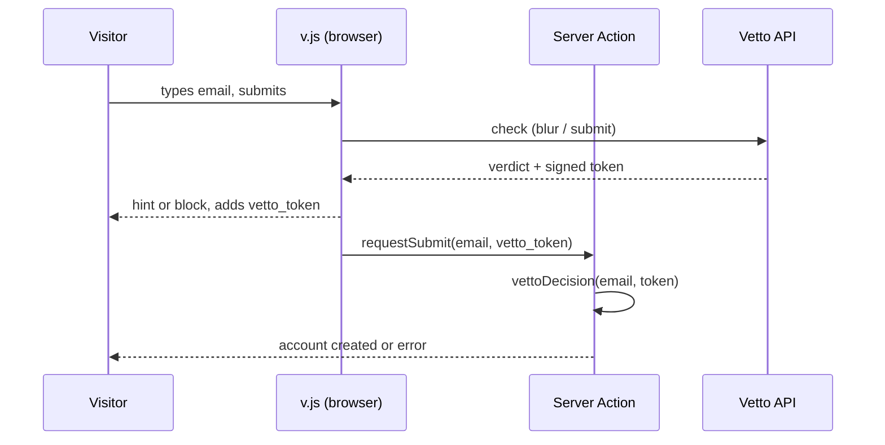

<div align="center">

<picture>
  <source media="(prefers-color-scheme: dark)" srcset="https://raw.githubusercontent.com/yasaiiko/nextjs-vetto-example/main/.github/banner-dark.svg">
  
</picture>

<br>

[](app)
[](app/actions.ts)
[](#run-it)
[](LICENSE)

**Throwaway, dead-domain and bot signups blocked. Typos fixed in one click. Real users never stuck.**

[Run it](#run-it) · [How it works](#how-it-works) · [Free vs Pro](#free-vs-pro) · [Other auth libraries](#using-another-auth-library)

</div>

---

## Two layers

| | Where | What it does |
|---|---|---|
| **1 · Browser** | one `<script>` in the layout | Checks the email on blur and on submit: "Did you mean jane@gmail.com?" for typos, blocks throwaway and dead domains, adds a hidden honeypot for bots |
| **2 · Server** | the Server Action | Checks again, so bots that post straight to your endpoint can't skip the browser |

Everything **fails open**: if Vetto is slow or down, signups go through.

| Address | Result |
|---|---|
| `jane@mailinator.com` | ✕ blocked: temporary inbox |
| `jane@gmial.com` | ↻ browser: "Did you mean jane@gmail.com?" with a one-click fix · server: rejected |
| `jane@doesnotexist-xyz-123.com` | ✕ blocked: domain cannot receive mail |
| `jane@privaterelay.appleid.com` | ✓ allowed: Apple Hide My Email reaches a real inbox |

## Run it

```bash
git clone https://github.com/yasaiiko/nextjs-vetto-example
cd nextjs-vetto-example
npm install
cp .env.example .env.local
npm run dev
```

It works **with no keys**: the server check uses the free, keyless [`/v1/audit`](https://usevetto.com/docs#domain-lookup) lookup. For the browser check, create a free account at [usevetto.com](https://usevetto.com) (1 site, 1,000 emails a month, no card), add your production domain and paste the `pk_...` key into `NEXT_PUBLIC_VETTO_SITE_KEY`. The key also works on `localhost`.

## How it works



| File | Role |
|---|---|
| [`app/layout.tsx`](app/layout.tsx) | The script tag. It finds email fields by itself, so the form needs no changes |
| [`app/actions.ts`](app/actions.ts) | Reads `email` and `vetto_token` (added by the script on submit) and calls `vettoDecision()` |
| [`lib/vetto.ts`](lib/vetto.ts) | The server check, free or Pro (below) |

```tsx
<Script src="https://usevetto.com/v.js" data-site={process.env.NEXT_PUBLIC_VETTO_SITE_KEY} strategy="afterInteractive" />
```

The script listens for `submit` in the capture phase and re-submits with `requestSubmit()`, so it works with React forms and Server Actions (`<form action={...}>`).

## Free vs Pro

| | Free (no secret key) | Pro (`VETTO_SECRET_KEY`) |
|---|---|---|
| Server check | `POST /v1/audit` with the domain: throwaway or dead → reject | Verify the signed `vetto_token` offline (HMAC, 15-min TTL, bound to the email) |
| No or invalid token (bot skipped the browser) | Same domain lookup | `POST /v1/check` with your secret key |
| Extra signals | — | Gmail alias farming (`j.a.n.e+1@gmail.com`), VPN and data-center signups, burst limits, your own deny list |
| Limits | 300 lookups a day per server IP | 20,000 checks a month per site |

## Using another auth library?

Keep the same split: the script tag in your layout, and `vettoDecision(email, token)` before you create the user.

| | |
|---|---|
| **Better Auth** | [`better-auth-vetto`](https://github.com/yasaiiko/better-auth-vetto) does the server check offline with a CC0 list, no API calls |
| **Auth.js / NextAuth** | Call it in the `signIn` callback ([guide](https://usevetto.com/block-disposable-emails-nextauth)) |
| **Supabase** | A `before-user-created` hook ([repo](https://github.com/yasaiiko/supabase-vetto-hook) · [guide](https://usevetto.com/block-disposable-emails-supabase)) |

API reference: [usevetto.com/docs](https://usevetto.com/docs) · OpenAPI: [usevetto.com/openapi.json](https://usevetto.com/openapi.json) · MCP: [usevetto.com/mcp-server](https://usevetto.com/mcp-server)

## License

MIT. Maintained by the people who build [Vetto](https://usevetto.com).
